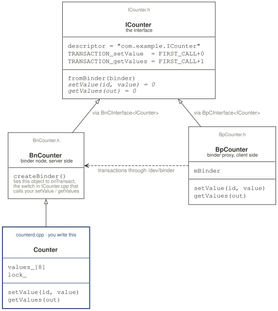
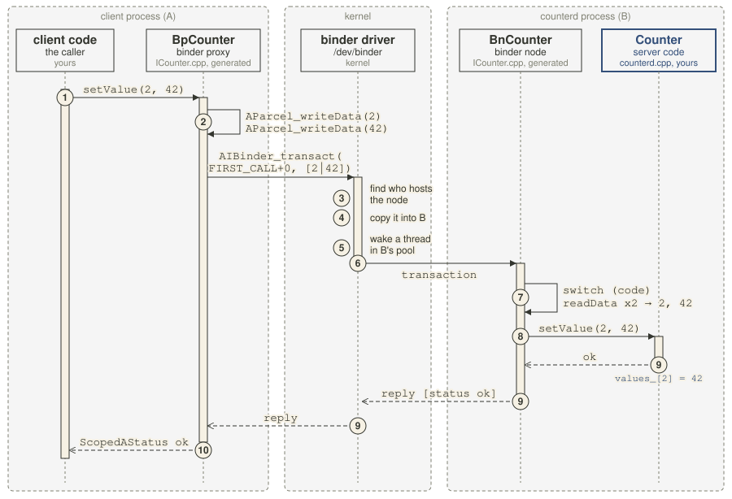

# Init service, part 1: AIDL

okayyyy so after thinking about how to teaching AIDL for longggggg time i can now have idea to wrote this =))

i think the best way to teach is with a real world example, so i decided to teach this as part 1 of Init service, since i already introduced it in [chapter 1](01-init-and-rc-file.md). this way you learn both at the same time, Init service and AIDL


# Explain AIDL

anyway welcome to AIDL chapter i hope you coming here from Binder chapter, if not you should read that chapter first it short and easy :D.

## Overview

i will go straight to explain in my words, AIDL is like a wrapper for Binder (IPC), we write a `.aidl` file to declare the interface we expose to the world, and the compiler will generate the code using binder to do it for you automatically

> more simple way to understand that: AIDL is Binder code generator.

- AIDL support both C++ and Java also

## Example

binder only moves bytes between processes. so if a client in one process wants to call a method that lives in another process, somebody has to pack the arguments into bytes on the client side, and unpack them on the other side. those bytes travel in a parcel.

for those who dont know what a parcel is: it is a box of bytes that binder carries, writing that packing and unpacking parcel by hand for every method is boring and easy to get wrong, so AIDL writes it for us.

i will create an simple Init service that keeps 8 numbers. a client can set one slot and read all of them back.

all the lab material is in `lab/init-service/` in the repo you can find it.

### 1. write the interface

so first we delcare the interface into the `.aidl` file to let compiler know what we want to expose.


```java
package com.example;

interface ICounter {
    void setValue(int id, int value);
    int[] getValues();
}
```

in the above mean we create a interface called `ICounter` with two methods, `setValue` and `getValues`.

### 2. run the compiler

in build.sh <- fill the like here for me git hub link
```console
AIDL=$HOME/Android/Sdk/build-tools/36.1.0/aidl

$ "$AIDL" --lang=ndk -o gen -h gen/include -I . com/example/ICounter.aidl
```

- `--lang=ndk` picks the C++ backend from the NDK, example you want it coding in rust you can change to `--lang=rust`
- `-o gen` is where the `.cpp` goes, `-h gen/include` is where the headers go
- `-I .` is the search path for `import` lines. `ICounter.aidl` has no imports, so nothing here depends on it

after running we got these file

```
/home/lazyming/security/android_notebook/lab/init-service/gen
> tree
.
├── com
│   └── example
│       └── ICounter.cpp
└── include
    └── aidl
        └── com
            └── example
                ├── BnCounter.h
                ├── BpCounter.h
                └── ICounter.h

7 directories, 4 files
```

the prefix of name have meaning:

- `I` is for **Interface** , declare interface for two bellow.
- `Bn` is for **Binder node**, the binder node sit in servier side
- `Bp` is for **Binder proxy**, the binder proxy sit in client side

here is the Diagram of code structure.


i will explain simply how it works first, so you have a clear picture before we jump into the real code:

it all works by OOP polymorphism. both `BnCounter` and `BpCounter` are an `ICounter`, because they inherit from `ICounter`. the client gets a `BpCounter`, and when it calls `setValue` or `getValues`, inside it just sends a transaction to the remote `BnCounter`. the real `setValue` and `getValues` live on the remote side, in the class we create that inherits `BnCounter`.

okay now lets go one by one, from the top of the diagram to the bottom.

#### ICounter.h

this is our `.aidl` file, just turned into C++:

```cpp
// gen/include/aidl/com/example/ICounter.h
class ICounter : public ::ndk::ICInterface {
  ...
  static const char* descriptor;
  ...
  static constexpr uint32_t TRANSACTION_setValue = FIRST_CALL_TRANSACTION + 0;
  static constexpr uint32_t TRANSACTION_getValues = FIRST_CALL_TRANSACTION + 1;

  static std::shared_ptr<ICounter> fromBinder(const ::ndk::SpAIBinder& binder);
  ...
  virtual ::ndk::ScopedAStatus setValue(int32_t in_id, int32_t in_value) = 0;
  virtual ::ndk::ScopedAStatus getValues(std::vector<int32_t>* _aidl_return) = 0;
```

three things to notice:

- decalre two interface `setValue` and `getValues` so bpcounter and npucounter can implemment the version from client and server (proxy and node) this is polymorfism in OOP

- every method got a number identifier, called the **transaction code**. `setValue` is `FIRST_CALL_TRANSACTION + 0`, `getValues` is `+ 1`. the proxy sends this number so the node knows which function is called. you will see it again as `_aidl_code` in the server code below

- `descriptor` is just the name `"com.example.ICounter"`

#### BnCounter.h, the server side

just reminder: server side = the node. it is the code other processes call, and it runs in its own process, not in the caller's.

```cpp
// gen/include/aidl/com/example/BnCounter.h
class BnCounter : public ::ndk::BnCInterface<ICounter> {
public:
  BnCounter();
  virtual ~BnCounter();
protected:
  ::ndk::SpAIBinder createBinder() override;
```

just a header and almost empty. it does not write `setValue` or `getValues`, that is your job. it just inherits the declarations of those two functions from `ICounter.h`. then you create `counterd.cpp`, write your own class that inherits `BnCounter`, and implement the server side logic there, see the code below

```cpp
// lab/init-service/counterd.cpp:16-45
// BnCounter is generated. we only fill in the two methods we declared
class Counter : public aidl::com::example::BnCounter {
 public:
  // set value implementation in server side
  ::ndk::ScopedAStatus setValue(int32_t id, int32_t value) override {
    if (id < 0 || id >= SLOTS) {
      return ::ndk::ScopedAStatus::fromServiceSpecificError(1);
    }

    // lock for race safe
    std::lock_guard<std::mutex> guard(lock_);
    values_[id] = value;

    // logging
    __android_log_print(ANDROID_LOG_INFO, TAG, "setValue(%d, %d) from uid %u",
                        id, value, AIBinder_getCallingUid());
    return ::ndk::ScopedAStatus::ok();
  }

  // getvalue implementation in server side
  ::ndk::ScopedAStatus getValues(std::vector<int32_t>* out) override {
    std::lock_guard<std::mutex> guard(lock_);
    out->assign(values_, values_ + SLOTS);
    return ::ndk::ScopedAStatus::ok();
  }

 private:
  std::mutex lock_;
  int32_t values_[SLOTS] = {};
};
```

<!-- the only thing left, `createBinder()`, we will discuss later -->

#### BpCounter.h aka proxy, the client side
now swtich to client side this side AIDL will implement all

```cpp
// gen/include/aidl/com/example/BpCounter.h
class BpCounter : public ::ndk::BpCInterface<ICounter> {
public:
  explicit BpCounter(const ::ndk::SpAIBinder& binder);
  virtual ~BpCounter();

  ::ndk::ScopedAStatus setValue(int32_t in_id, int32_t in_value) override;
  ::ndk::ScopedAStatus getValues(std::vector<int32_t>* _aidl_return) override;
```

this one does have both methods. AIDL implements them in `ICounter.cpp`, and all they do is send a transaction see section below

#### ICounter.cpp, the code behind all the headers

careful, the name lies a bit: `ICounter.cpp` is not only `ICounter`'s code. aidl makes one `.cpp` per `.aidl` file, so the bodies of `BpCounter::setValue`, `BnCounter::createBinder` and `onTransact` all live here too. look at the part before `::` to know which class a function belongs to.

this is the implementation of the client side `setValue`. it packs the arguments into a parcel, together with the identifier of the function we want to call, and sends it to binder

```cpp
// gen/com/example/ICounter.cpp:77-85
::ndk::ScopedAStatus BpCounter::setValue(int32_t in_id, int32_t in_value) {
_aidl_ret_status = ::ndk::AParcel_writeData(_aidl_in.get(), in_id);
...
_aidl_ret_status = ::ndk::AParcel_writeData(_aidl_in.get(), in_value);
...
_aidl_ret_status = AIBinder_transact(
  asBinderReference().get(),
  (FIRST_CALL_TRANSACTION + 0 /*setValue*/),
}
```

on the server side `onTransact` live in one thread gets the parcel, looks at the number, takes the arguments out in the same order, and calls your real `setValue`. it casts the object to `BnCounter`, and because your `Counter` in `counterd.cpp` inherits `BnCounter` and implements `setValue`, the call jump to your function:

```cpp
// gen/com/example/ICounter.cpp:25-37
std::shared_ptr<BnCounter> _aidl_impl = std::static_pointer_cast<BnCounter>(::ndk::ICInterface::asInterface(_aidl_binder));
switch (_aidl_code) {
  case (FIRST_CALL_TRANSACTION + 0 /*setValue*/): {
    ...
    _aidl_ret_status = ::ndk::AParcel_readData(_aidl_in, &in_id);
    ...
    _aidl_ret_status = ::ndk::AParcel_readData(_aidl_in, &in_value);
    ...
    ::ndk::ScopedAStatus _aidl_status = _aidl_impl->setValue(in_id, in_value);
```


so the whole job of AIDL in one line: write on client side for you, you wrote the server side, ere is the full trip, the numbers match [Figure 1 of the google binder page](https://source.android.com/docs/core/architecture/ipc/binder-overview):


